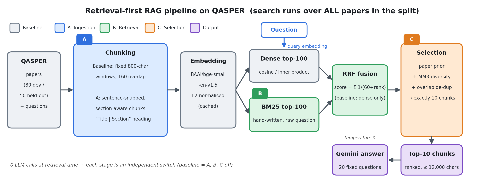

# 🔬 Optimizing Retrieval-Augmented Generation (RAG) on the QASPER Dataset

> A controlled, retrieval-first study of **why a naive RAG retriever fails on scientific papers** and **which low-cost, LLM-free changes measurably help**.
> Every number below is taken from the executed notebook (`RAG_Optimization.ipynb`, Google Colab). All comparisons are against a fixed baseline, on a fixed 80/50-paper split, with seed 42.

---

## 📌 Executive summary

| | Baseline | Final (A + B + C) | Change |
| :--- | :---: | :---: | :---: |
| **Held-out Recall@10** (155 scored questions) | 19.52% | **29.78%** | +10.3 pts (+52.6% rel.) |
| **Held-out Recall@5** | 12.85% | **20.36%** | +7.5 pts (+58.4% rel.) |
| **Held-out MRR@10** | 0.0995 | **0.1702** | +0.071 (+71.1% rel.) |
| Retrieval latency (median) | 16.06 ms | 23.83 ms | +7.8 ms |
| Extra LLM calls per query | 0 | 0 | none |

**Key findings**

1. **Ingestion is the dominant lever.** Sentence-snapped, section-aware chunks (A) alone give +6.0 pts R@10 on dev; retrieval-side changes (B, C) alone give < 0.5 pts.
2. **A and B interact strongly.** A+B reaches 30.84% R@10 on dev, versus +6.3 pts expected from adding their separate gains (actual: +9.5 pts).
3. **Selection (C) adds little once A and B are in place.** A+B scores *the same or marginally higher* than A+B+C on dev (R@10 30.84% vs 30.70%) while being ~7.6 ms faster. See [Discussion](#7--discussion).
4. **Gains generalize.** Held-out R@10 (29.78%) is within 1 pt of dev (30.70%); held-out data was never used for selection.
5. **Better retrieval did not improve answer F1 on the 20-question sample** (0.188 → 0.129; one question ≈ 5 pts), a result too small to be conclusive. See [§6.3](#63-answer-generation-20-fixed-held-out-questions).

---

## 📑 Contents

1. [Problem and scope](#1--problem-and-scope)
2. [Experimental setup](#2--experimental-setup)
3. [Pipeline](#3--project-pipeline-visualization)
4. [Methods](#4--methods)
5. [Evaluation protocol](#5--evaluation-protocol)
6. [Results](#6--results)
7. [Discussion](#7--discussion)
8. [Limitations and threats to validity](#8--limitations-and-threats-to-validity)
9. [Future work](#9--future-work)
10. [Reproducing the results](#10--reproducing-the-results)
11. [Repository layout](#11--repository-layout)
12. [Requirement compliance](#12--requirement-compliance)
13. [References](#13--references)

---

## 1. 🎯 Problem and scope

QASPER pairs questions with scientific papers and marks the paragraph(s) that contain the answer (*gold evidence*). In a RAG system, if retrieval misses that evidence, no generator can answer correctly. This project therefore optimizes and measures **retrieval**; generation is evaluated only on a small fixed sample for cost reasons.

Two properties make the task harder than single-document QA:

* **Search spans every paper in the split.** The index is never filtered to the target paper, so the retriever must also infer *which* paper a question concerns. Generic questions ("Which dataset(s) do they experiment with?") match text in many papers.
* **Only target-paper evidence counts** and a gold paragraph must be **≥ 80% covered** (by word tokens) to be credited.

**Scope:** three independent optimizations (ingestion, retrieval, selection), none using LLM calls at retrieval time.

---

## 2. 🧪 Experimental setup

| Item | Setting |
| :--- | :---: |
| Dataset | QASPER validation split (pinned revision `0fbdb8ed…`) |
| Development set | 80 papers · 295 questions · **261 scored** (have text gold evidence) |
| Held-out set | 50 papers · 182 questions · **155 scored** |
| Answer sample | 20 fixed held-out question IDs (from the organizer's snippet) · **1 gold-unanswerable** |
| Split / sampling seed | 42 |
| Embedding model | `BAAI/bge-small-en-v1.5` (L2-normalized, cosine via inner product; BGE query instruction prefix on queries) |
| Answer generator | `gemini-3.5-flash-lite`, temperature 0 |
| Vector search | Exact brute-force inner product (no ANN; corpus ≈ 5k chunks) |
| Runtime | Google Colab, Python 3.13 · `sentence-transformers` 5.7.0 · `torch` 2.11.0 · `datasets` 4.8.5 · `numpy` 2.1.3 · `pandas` 2.2.3 · `google-genai` 2.12.1 |

Questions without retrievable text evidence (unanswerable, or figure/table-only evidence) are excluded from retrieval metrics: 34 of 295 on dev, 27 of 182 held-out.

**Protocol:** development questions were used to diagnose failures and choose optimizations. Held-out questions were used **once**, for the final baseline-vs-final comparison.

---

## 3. 🧭 Project Pipeline Visualization

<p align="center">
  
</p>
<p align="center"><em>Figure 1. End-to-end pipeline. Colors mark the stage each optimization belongs to (A ingestion, B retrieval, C selection).</em></p>

*Baseline path (all stages off):* `Papers → fixed 800-char windows → dense search → Top-10`.
*Final path:* all three stages enabled. Each stage is an independent switch, so any subset can be run for the ablation.

The switches on `PipelineConfig` that make the ablation reproducible:

| Config | `chunker` | `hybrid` (B) | `rerank` (C) |
| :--- | :---: | :---: | :---: |
| baseline | fixed | off | off |
| **A** | **structure** | off | off |
| **B** | fixed | **on** | off |
| **C** | fixed | off | **on** |
| final | structure | on | on |

---

## 4. 🔧 Methods

### 4.1 Baseline
Overlapping fixed-length character windows over each paper (800 chars, 160 overlap) → `bge-small` embeddings → exact dense retrieval over all chunks → top 10. Document embeddings and query embeddings are cached; the original query-encode time is added back to latency so timings remain honest.

### 4.2 A: Structure-aware ingestion (stage: ingestion)
* **Failure addressed:** fixed windows cut evidence mid-sentence and across sections, so neither half is a good chunk representation and a gold paragraph may never reach 80% coverage.
* **Method:** pack whole sentences within a section (max 900 chars; prefer a paragraph break once a chunk holds ≥ 250 chars). The text sent to the **embedder** is prefixed with `Title | Section` (contextual heading); the **returned text and `source_spans` remain exact excerpts** of the original paragraph. No overlap, hence no near-duplicate chunks.

### 4.3 B: Hybrid dense + BM25 with Reciprocal Rank Fusion (stage: retrieval)
* **Failure addressed:** dense vectors blur rare exact tokens (acronyms, dataset/model names, numbers).
* **Method:** a from-scratch Okapi BM25 (own tokenizer with stop-words and light plural stemming, document frequencies, IDF, scoring) runs beside the dense retriever. The two ranked lists are fused with RRF: `score(d) = Σ 1 / (k + rank)`, `k = 60`. Fusing *ranks* avoids calibrating cosine scores against BM25 scores.
* **BM25:** `IDF(t) · tf·(k1+1) / (tf + k1·(1 − b + b·|d|/avgdl))`, `IDF = ln(1 + (N − df + 0.5)/(df + 0.5))`.

### 4.4 C: Paper-aware MMR selection (stage: selection / ranking)
* **Failure addressed:** overlapping windows return near-duplicate passages, and chunks from many papers compete although QASPER evidence is clustered in one paper.
* **Method:** (1) min-max normalize candidate scores; (2) add a **paper prior**: mean of the paper's top-3 normalized chunk scores × 0.30; (3) choose the final 10 by **MMR**, `argmax λ·relevance − (1 − λ)·max cosine to chosen`, λ = 0.75; (4) skip any chunk whose characters are > 50% already shown.

### 4.5 Hyper-parameters

| Parameter | Value | Parameter | Value |
| :--- | :---: | :--- | :---: |
| Fixed chunk size / overlap | 800 / 160 | RRF `k` | 60 |
| Structure chunk max / min | 900 / 250 | Rerank pool | 50 |
| BM25 `k1` / `b` | 1.2 / 0.75 | Paper prior top-m / weight | 3 / 0.30 |
| Candidates per ranker | 100 | MMR λ / dedup overlap | 0.75 / 0.50 |

Values were fixed a priori (defaults in `ragopt/config.py`); none were tuned on held-out data.

---

## 5. 📐 Evaluation protocol

* **Coverage rule:** a gold paragraph is *covered* when the union of spans from retrieved chunks **of the target paper** includes ≥ 80% of its word tokens.
* **Recall@k:** covered gold paragraphs ÷ gold paragraphs, averaged over scored questions (gold = union of annotators' evidence).
* **MRR@10 (cumulative):** 1/r at the first rank r where the top-r union covers any gold paragraph.
* **Answer F1:** SQuAD-style normalized token F1 against the best reference, on gold-answerable questions only; an abstention scores 0.
* **False-answer rate:** share of gold-unanswerable questions that received an answer.
* **Latency:** query-encode time + search. For the 20 answered questions, generation time is reported in a **separate** median; the two scopes are never mixed.
* **LLM calls:** 0 for retrieval; 1 per answered question. (The held-out table's `0.1099` is 20 calls ÷ 182 questions, not a per-answer figure.)

---

## 6. 📈 Results

### 6.1 Development ablation (80 papers · 261 scored questions)

| Configuration | R@5 | R@10 | MRR@10 | Retrieval latency | LLM calls/q |
| :--- | :---: | :---: | :---: | :---: | :---: |
| Baseline | 13.88% | 21.30% | 0.1018 | 14.99 ms | 0 |
| Baseline + A | 18.34% | 27.32% | 0.1440 | 15.12 ms | 0 |
| Baseline + B | 16.35% | 21.63% | 0.1114 | 15.29 ms | 0 |
| Baseline + C | 14.55% | 21.68% | 0.1024 | 22.98 ms | 0 |
| **Final (A + B + C)** | **22.70%** | **30.70%** | **0.1736** | 22.93 ms | 0 |

**Supplementary pairwise combinations** (dev only, not required by the task):

| Configuration | R@5 | R@10 | MRR@10 | Retrieval latency |
| :--- | :---: | :---: | :---: | :---: |
| A + B | **23.50%** | **30.84%** | **0.1747** | 15.33 ms |
| A + C | 18.61% | 29.44% | 0.1471 | 22.64 ms |
| B + C | 16.16% | 22.76% | 0.1120 | 23.48 ms |

### 6.2 Held-out comparison (50 papers · 155 scored questions)

| Configuration | R@5 | R@10 | MRR@10 | Retrieval latency |
| :--- | :---: | :---: | :---: | :---: |
| Baseline | 12.85% | 19.52% | 0.0995 | 16.06 ms |
| **Final (A + B + C)** | **20.36%** | **29.78%** | **0.1702** | 23.83 ms |

### 6.3 Answer generation (20 fixed held-out questions)

| Metric | Baseline | Final |
| :--- | :---: | :---: |
| Gold-answerable / gold-unanswerable in sample | 19 / 1 | 19 / 1 |
| Answer F1 (answerable only) | 0.188 | 0.129 |
| Abstention rate | 55% (11/20) | 60% (12/20) |
| False-answer rate | 0.0 (0/1) | 0.0 (0/1) |
| Median latency, retrieval-only (other 162 questions) | 16.07 ms | 23.81 ms |
| Median latency, retrieval + generation (the 20) | 14,011 ms | 11,072 ms |
| LLM calls per answered question | 1 | 1 |

**How to read this table.** The sample is tiny: with 19 answerable questions, one question is worth up to 5.3 F1 points, so the 0.059 F1 gap is roughly one question and is **not statistically meaningful**. The false-answer rate rests on a **single** unanswerable question and is uninformative. The retrieval+generation latency difference is dominated by Gemini API response time (seconds), not by retrieval (a ~8 ms difference), so it should not be attributed to either retriever. Both systems abstain on more than half of the questions; since Recall@10 is only ~20–30%, the gold paragraph is absent from the context for most questions, so frequent abstention is expected.

### 6.4 Failure analysis (10 poor baseline cases, development set)

Cases were selected from questions with Recall@10 = 0 and tagged automatically (`boundary`, `wrong_paper`, `repetitive`, `miss`), then inspected with `show_case`.

| # | Question ID | Question | Tag | Evidence / likely cause | Fix | Status |
| :--- | :---: | :---: | :---: | :---: | :---: | :---: |
| 1 | `a313e989` | How do they match words before reordering them? | boundary | Gold paragraph `s8:p2` (CFILT-preorder system) not retrieved; top-1 is a *different* paragraph of the target paper. Competing results from other papers also discuss "reordering". | A | Inspected |
| 2 | `7e62a538` | Which dataset(s) do they experiment with? | wrong_paper | Generic question: top-3 chunks all come from other papers' dataset sections; gold `s7:p0` never surfaces. | B, C | Inspected |
| 3 | `483a699c` | Was the approach … to detect fake news fully supervised? | repetitive | Top-1 is the target paper's abstract chunk, not gold `s1:p0`; ranks 2–3 are overlapping windows (`fc12`, `fc13`) of the same passage in another paper. | C | Inspected |
| 4 | `f7a89b9c` | Which types of named entities do they recognize? | miss | Auto-tag: no structural cause, likely vocabulary mismatch | B | Auto-tagged |
| 5 | `bc16ce6e` | What is the average length of dialog? | boundary + wrong_paper | Auto-tag | A, B | Auto-tagged |
| 6 | `455d4ef8` | How was this data collected? | wrong_paper | Auto-tag: generic question | B, C | Auto-tagged |
| 7 | `d3ff2986` | …more predictive set of features to detect fake news? | repetitive | Auto-tag: duplicated windows | C | Auto-tagged |
| 8 | `beac555c` | What useful information does attention capture? | miss | Auto-tag: abstract question | B | Auto-tagged |
| 9 | `da55bd76` | What kind of repetitive and time-consuming activities does their assistant handle? | boundary | Auto-tag | A | Auto-tagged |
| 10 | `1ff0fccf` | How are models evaluated in this human-machine communication game? | wrong_paper | Auto-tag | B, C | Auto-tagged |

Tag counts among the 10 *selected* worst cases (selection is balanced across tags, so counts reflect case availability, not prevalence):

| Primary tag | Baseline | Final system |
| :--- | :---: | :---: |
| boundary | 3 | 4 |
| wrong_paper | 3 | 3 |
| repetitive | 2 | **0** |
| miss | 2 | 3 |

Only the `repetitive` symptom disappeared. Boundary and wrong-paper cases persist (see [§7](#7--discussion)).

---

## 7. 💡 Discussion

**What the ablation supports**

* **A is the single most effective change** (+6.0 pts R@10, +28% relative; +4.5 pts R@5). It also costs essentially no latency (+0.13 ms).
* **B mostly helps the top of the ranking:** +2.5 pts R@5 but only +0.3 pts R@10 on its own. With fixed windows a matched passage is often still only partly covered.
* **A and B reinforce each other.** A+B improves R@10 by +9.5 pts, versus +6.3 pts from summing the individual gains. Intact, headed sentences give BM25 cleaner term statistics and the dense retriever cleaner vectors.
* **C alone is nearly neutral** (+0.4 pts R@10, +0.7 pts R@5), at a cost of ≈ +8 ms per query, almost entirely MMR (A and B add < 0.3 ms).

**What the ablation does not support (important)**

* **C's benefit shrinks as the base improves.** C adds +2.1 pts R@10 on top of A and +1.1 pts on top of B, but **−0.1 pts on top of A+B** (R@5: −0.8 pts). On dev, A+B is therefore the best quality-per-millisecond configuration; A+B+C was fixed as the final system before the pairwise runs and is kept here because it was the pre-declared design. A+B should be considered the more economical choice.
* **The paper prior did not resolve wrong-paper failures:** `wrong_paper` cases stayed at 3 of 10 after C. What C demonstrably did is remove duplicate-driven failures (`repetitive`: 2 → 0).
* **Boundary failures persist** after A (3 → 4 among the selected cases), likely because a 900-char chunk still cannot cover a longer gold paragraph on its own; the 80% rule is then met only if several adjacent chunks are retrieved.

**Quality versus cost**

All three optimizations are LLM-free. A and B cost under 0.3 ms per query. C costs ≈ 8 ms per query (MMR over a 50-candidate pool). One-off costs: sentence packing and BM25 indexing take seconds. Generation cost is identical across systems (20 calls each).

**On the remaining recall gap**

Absolute Recall@10 (~30%) is modest. Plausible contributors, to be confirmed by further analysis: cross-paper search with generic questions; the strict 80% coverage rule; recall averaged over *every* gold paragraph (multi-evidence questions are hard); and the small embedding model.

---

## 8. 🚧 Limitations and threats to validity

* **Single run, single seed, no confidence intervals.** Differences below ~1 pt (e.g. C's marginal effects, A+B vs A+B+C) should be treated as within noise.
* **Small answer sample.** Twenty questions, one gold-unanswerable: F1 and false-answer rate cannot rank the systems.
* **Gold derivation.** Gold = union of annotators' evidence, mapped to paragraphs by exact/containment text match; unmatched evidence is dropped, and figure/table evidence is not retrievable as text.
* **MRR definition.** Cumulative (first rank at which the top-r union covers any gold paragraph), which differs from a strict single-chunk MRR.
* **Failure analysis.** Seven of ten cases are auto-tagged; tag counts on 10 selected cases are descriptive, not estimates of prevalence.
* **Latency.** Measured on a shared Colab runtime with cached query encodings (original encode time re-added); compare timings only within the same session.
* **Prompt sensitivity.** The generation prompt instructs abstention when evidence is insufficient; abstention rate (55–60%) strongly shapes F1.

---

## 9. 🔭 Future work

| Idea | Rationale / expected effect |
| :--- | :---: |
| Cross-encoder reranking (e.g. `ms-marco-MiniLM`, `bge-reranker`) | Joint query–chunk scoring over the top ~30 candidates; likely the next gain, at one model pass per candidate. |
| Chunk-size / overlap-of-context sweep (A) | Quantify the precision-vs-coverage trade-off behind the persistent boundary failures; consider small-to-big (return the parent paragraph). |
| Stronger paper-routing signal | Aggregate over title/abstract embeddings to attack `wrong_paper` failures that the current prior did not fix. |
| Query rewriting / HyDE / multi-query | Targets vocabulary-mismatch misses; costs LLM calls per query. |
| HNSW / IVF indexes | Speed only, no quality gain; relevant above ~100k chunks (here ≈ 5k, exact search ≈ 1 ms). |
| Larger answer sample and repeated runs | Needed to draw conclusions about downstream answer quality. |

---

## 10. 🚀 Reproducing the results

**Environment:** Google Colab, GPU runtime recommended. Use one session for baseline and final so latencies are comparable.

```python
# 1. Mount Drive and enter the project
from google.colab import drive
drive.mount('/content/drive')
%cd /content/drive/MyDrive/rag_opt

# 2. Install dependencies
!pip install -q -r requirements.txt

# 3. Provide the Gemini key via Colab Secrets (key name: GEMINI_API_KEY)
import os
from google.colab import userdata
os.environ["GEMINI_API_KEY"] = userdata.get("GEMINI_API_KEY")

# 4. Optional offline sanity check
!python -m tests.smoke_test          # expect: "smoke test passed"
```

Then run `RAG_Optimization.ipynb` top to bottom.

| Notebook section | Output |
| :--- | :---: |
| Data | split sizes, scored-question counts, gold-unanswerable count in the 20 |
| Baseline | `results/dev_baseline.jsonl` |
| Diagnosis | `results/failure_table.csv` |
| Optimizations A, B, C | `dev_A.jsonl`, `dev_B.jsonl`, `dev_C.jsonl` |
| Final | `dev_final.jsonl`, `dev_ablation.csv` |
| Held-out | `heldout_baseline.jsonl`, `heldout_final.jsonl`, `heldout_retrieval.csv`, `heldout_answers.csv` |
| Validation | confirms each JSONL satisfies the submission format |

**Determinism:** fixed seed 42, exact search, no stochastic retrieval step. Embeddings and LLM responses are cached under `cache/`; delete `cache/` to recompute from scratch.

**Secrets and version control**

* Keep `GEMINI_API_KEY` and any GitHub token in Colab Secrets; never write them into notebook cells, committed files, or a git remote URL.
* Commit a `.gitignore` containing `cache/`, `.env`, `__pycache__/`, `*.zip`, `.ipynb_checkpoints/`.
* If a token has ever been embedded in a remote URL (`https://<token>@github.com/...`), revoke it, issue a new one, and reset the remote with `git remote set-url origin https://github.com/mulata12/Rag-Optimization.git`.

---

## 11. 📂 Repository layout

| Path | Role |
| :--- | :---: |
| `RAG_Optimization.ipynb` | End-to-end driver |
| `assets/pipeline.png` | Pipeline figure used in this README (regenerate with `python assets/make_pipeline.py`) |
| `ragopt/config.py` | Seed, models, **all hyper-parameters**, pipeline switches (`CONFIGS`) |
| `ragopt/data.py` | Split, paragraph IDs, gold mapping, the 20 answer question IDs |
| `ragopt/chunking.py` | Baseline fixed chunker and **A** structure-aware chunker |
| `ragopt/bm25.py` | From-scratch BM25 (tokenizer, DF, IDF, scoring), **B** |
| `ragopt/retrieval.py` | Dense search, RRF fusion, switch logic |
| `ragopt/rerank.py` | **C**: paper prior, MMR, span-overlap deduplication |
| `ragopt/embed.py` | Embedding with document and query caches |
| `ragopt/metrics.py` | R@5, R@10, MRR@10 (80% coverage), Answer F1 |
| `ragopt/generate.py` | Gemini generation (temperature 0), cached |
| `ragopt/diagnosis.py` | Failure tagging and case viewer |
| `ragopt/io_utils.py` | JSONL writer and submission-rule validator |
| `tests/smoke_test.py` | Offline test on synthetic papers |
| `results/` | Seven submission `.jsonl` files plus CSV reports |

---

## 12. ✅ Requirement compliance

| Requirement | How it is met |
| :--- | :---: |
| Same 80/50 split and 20 answer questions | Organizer snippet reproduced verbatim in `data.py` (seed 42) |
| Search all papers; score only target-paper evidence | `Retriever.search` applies no paper filter; `gold_coverage` ignores other papers' chunks |
| Cached document and query embeddings | Hash-keyed `.npy` files; query vectors cached with original encode time |
| ≥ 3 changes across ≥ 2 stages, tested independently | A (ingestion), B (retrieval), C (selection), each run on top of the baseline alone |
| BM25 implemented by hand | `ragopt/bm25.py`; no `rank_bm25` |
| R@5, R@10, MRR@10, latency, LLM calls | `Experiment.summarize` (§6.1, §6.2) |
| Answers only for the 20 questions; F1 and false-answer rate; unanswerable count reported | §6.3 (1 gold-unanswerable; false-answer rate exploratory) |
| Separate latency scopes | Retrieval-only vs retrieval + generation medians (§6.3) |
| Seven JSONL files with exact format | `io_utils.validate_jsonl` returned OK for all seven (295 dev and 182 held-out records) |
| Failure analysis of ≥ 10 cases | §6.4 |
| No tuning on held-out | Final design fixed from development data; held-out run once |

---

## 13. 📚 References

* Dasigi et al., 2021. *A Dataset of Information-Seeking Questions and Answers Anchored in Research Papers* (QASPER). NAACL.
* Xiao et al., 2023. *C-Pack: Packaged Resources To Advance General Chinese Embedding* (BGE embeddings).
* Robertson & Zaragoza, 2009. *The Probabilistic Relevance Framework: BM25 and Beyond.* Foundations and Trends in IR.
* Cormack, Clarke & Büttcher, 2009. *Reciprocal Rank Fusion Outperforms Condorcet and Individual Rank Learning Methods.* SIGIR.
* Carbonell & Goldstein, 1998. *The Use of MMR, Diversity-Based Reranking for Reordering Documents and Producing Summaries.* SIGIR.

---

## 📦 Deliverables
- **Personal Repository**: [mulata12/Rag-Optimization](https://github.com/mulata12/Rag-Optimization)
- **Zipped Outputs**: `rag_optimization_results.zip` containing all 7 validated submission `.jsonl` files.
